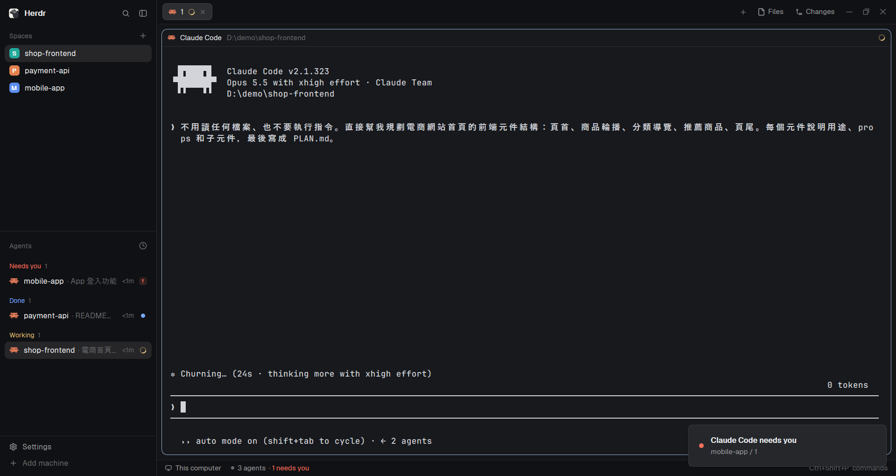
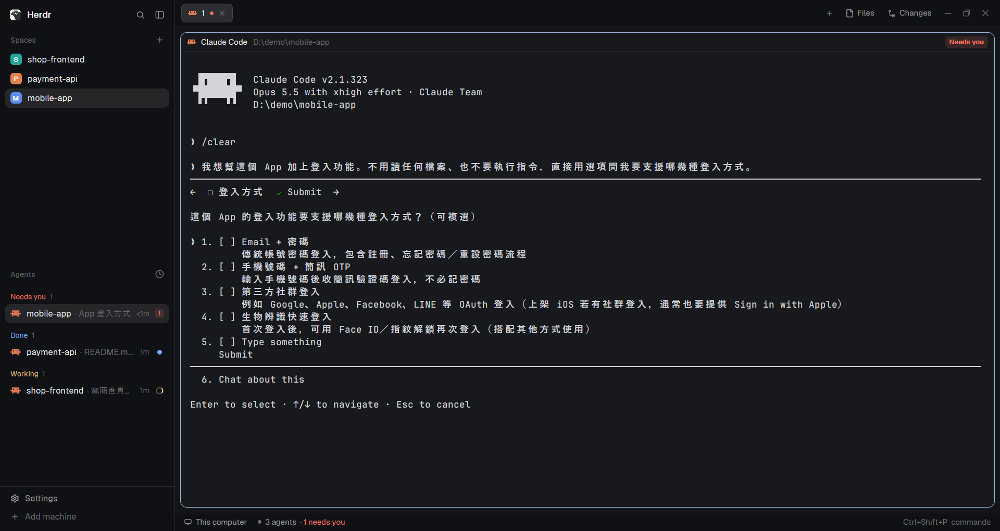

# hclaude

[繁體中文](README.md) | **English**

**A small Windows tool for [Herdr](https://herdr.dev) users: open [Claude Code](https://claude.com/claude-code) inside Herdr from File Explorer, in one step.**



*Each of the three projects had Claude opened with `hclaude`. The agents list at the bottom left shows mobile-app waiting for you (Needs you), payment-api finished (Done), and shop-frontend still working (Working). The notification in the corner comes from Herdr.*

## Why this exists

### What Herdr is

[Herdr](https://herdr.dev) is a desktop app for terminals and AI coding agents. If you have several Claude Code sessions working in different projects at once, Herdr helps you:

- **Keep projects apart.** Each project is a space, with its own tabs and terminals.
- **See every Claude's status at a glance.** The agents list on the left shows live whether each one is working, finished, or waiting for your answer or permission.
- **Get told when you're needed.** When a Claude is waiting on you, or finishes while you're looking elsewhere, Herdr plays a sound and shows a notification. Click it to jump straight there.

[Claude Code](https://claude.com/claude-code) is Anthropic's AI coding assistant that runs in your terminal. Its command is `claude`.

### The problem with the usual way

On Windows, many people start Claude Code like this:

> Open the project folder in File Explorer → type `claude` in the address bar → press Enter

It's quick, but **Claude then runs in a plain console window, not in Herdr**. Herdr only shows terminals it started itself, so:

- Herdr's agents list can't see that Claude, and won't notify you when it needs you.
- A Claude that's already running can't be moved into Herdr later. You have to close it and start it again.

To start Claude inside Herdr instead, you had to:

1. Open Herdr
2. Go back to File Explorer and copy the project folder's path
3. Type `cd <path>` in a Herdr terminal
4. Type `claude`

You'd repeat all four steps for every project, which is a lot more work than the address-bar habit.

### What hclaude does about it

**hclaude turns those four steps into one.** Your habit barely changes:

- Type **`hclaude`** in File Explorer's address bar instead of `claude`, or
- Right-click the folder and choose **Open Claude in Herdr**

Claude Code then opens in that folder, inside Herdr. If Herdr already has a space for the project, Claude opens as a new tab there instead of creating a duplicate space.

| | Typing `claude` in the address bar | hclaude |
|---|---|---|
| How you start it | Type `claude` | Type `hclaude`, or right-click |
| Where Claude runs | A separate console window | Inside Herdr, in the project's space |
| Seeing its status | Switch to its window and look | Live in Herdr's agents list |
| Notified when it needs you | No | Yes: a sound and a notification |

When a Claude is waiting for your answer or permission, it goes to the top of the agents list under "Needs you". Click it to jump straight to that Claude and answer:



## What it does

When you run `hclaude` in a folder, it:

1. Starts Herdr, or brings its window to the front if it's already running.
2. Starts Claude Code in that folder, inside Herdr:
   - If a Herdr space already points at the folder, Claude opens as a new tab in that space and the space is selected.
   - Otherwise, a new space is created for the folder.
3. Passes any arguments through to `claude`.

| You type | Result |
|---|---|
| `hclaude` | Claude Code in this folder, in Herdr |
| `hclaude --continue` | Continue the most recent conversation in this folder |
| `hclaude --resume` | Pick a past conversation to resume |

It works from File Explorer's address bar, `cmd`, Windows PowerShell 5.1 and PowerShell 7.

### Right-click menu

You can also right-click a folder, or empty space inside one, and choose **Open Claude in Herdr**. This does the same as typing `hclaude` there.

- **Windows 11:** the item is under **Show more options**. Shift+right-click opens that menu directly. Windows 11 doesn't let apps add items to its new top-level menu through the registry.
- The label follows your Windows display language: 在 Herdr 開啟 Claude (Traditional Chinese), 在 Herdr 中打开 Claude (Simplified Chinese), and English otherwise.

## Requirements

- Windows 10 or 11
- [Herdr](https://herdr.dev), the desktop app (installed per user, or `herdr-app.exe` on your `PATH`)
- [PowerShell 7](https://learn.microsoft.com/powershell/scripting/install/installing-powershell-on-windows) (`pwsh`): `winget install Microsoft.PowerShell`
- [Claude Code](https://claude.com/claude-code), with `claude` on your `PATH`

## Install

Run this in PowerShell:

```powershell
irm https://raw.githubusercontent.com/wjfans/hclaude/main/install.ps1 | iex
```

The installer:

- copies `hclaude.cmd` and `hclaude-run.ps1` to `%USERPROFILE%\.local\bin`
- adds that folder to your user `PATH` if it isn't there yet
- adds the File Explorer right-click menu item (for your user only; no admin rights needed)
- tells you if PowerShell 7, Herdr or Claude Code is missing

If File Explorer doesn't find `hclaude` right after you install it, sign out and back in once. To update, run the same command again.

### Manual install

1. Download [`hclaude.cmd`](hclaude.cmd) and [`hclaude-run.ps1`](hclaude-run.ps1). Use the download button on each file's page; don't copy and paste the text.
2. Put both files in the same folder on your `PATH`.
3. If you downloaded them in a browser, unblock them: `Get-ChildItem <folder>\hclaude* | Unblock-File`.

A manual install doesn't add the right-click menu. Use the installer if you want it.

Keep `hclaude-run.ps1` saved as **UTF-8 with BOM**. Without the BOM, Windows PowerShell 5.1 can't read its non-ASCII comments and messages. If you edit the file, make sure your editor keeps the BOM.

## How it works

- `hclaude.cmd` is the command you type. It launches `hclaude-run.ps1` with `pwsh -ExecutionPolicy Bypass` in a hidden window of its own. That way your PowerShell execution policy doesn't matter, and the window you typed in stays as it is.
- `hclaude-run.ps1` uses the `herdr-app` CLI:
  - `herdr-app ls` finds an existing space for the folder.
  - `herdr-app do space.new` or `herdr-app do tab.new` starts `claude` there.
- The right-click item is a per-user shell verb at `HKCU\Software\Classes\Directory\shell\hclaude`, and at `...\Directory\Background\shell\hclaude` for empty space inside a folder. It runs `cmd.exe /d /c cd /d "%V" && "<install folder>\hclaude.cmd"`.
- The logic script is deliberately not named `hclaude.ps1`. PowerShell runs a `.ps1` before a `.cmd` with the same name, so that name would put the script under your execution policy again.

## Troubleshooting

| Symptom | Fix |
|---|---|
| `'hclaude' is not recognized` | The install folder isn't on `PATH` in that window yet. Open a new window, or sign out and back in. |
| `hclaude needs PowerShell 7` | `winget install Microsoft.PowerShell` |
| Error dialog: can't find Herdr / `claude` | Install the missing program, or put it on your `PATH`. |
| Error dialog: Herdr did not respond within 30 seconds | Start Herdr once by hand and check that it opens. |
| A new space every time, instead of a new tab | A space matches only while its first terminal is still in that folder. If you `cd` somewhere else in it, `hclaude` creates a new space. |

## Uninstall

```powershell
irm https://raw.githubusercontent.com/wjfans/hclaude/main/uninstall.ps1 | iex
```

This removes both scripts and the right-click menu item. `%USERPROFILE%\.local\bin` stays on your `PATH`, because other tools, such as Claude Code's own installer, use that folder too.

## License

[MIT](LICENSE)

This is an unofficial community tool. It is not affiliated with Anthropic or with Herdr.
